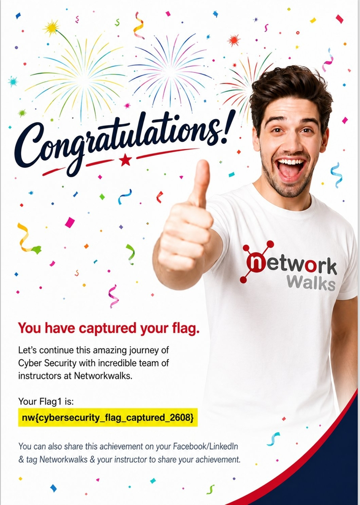
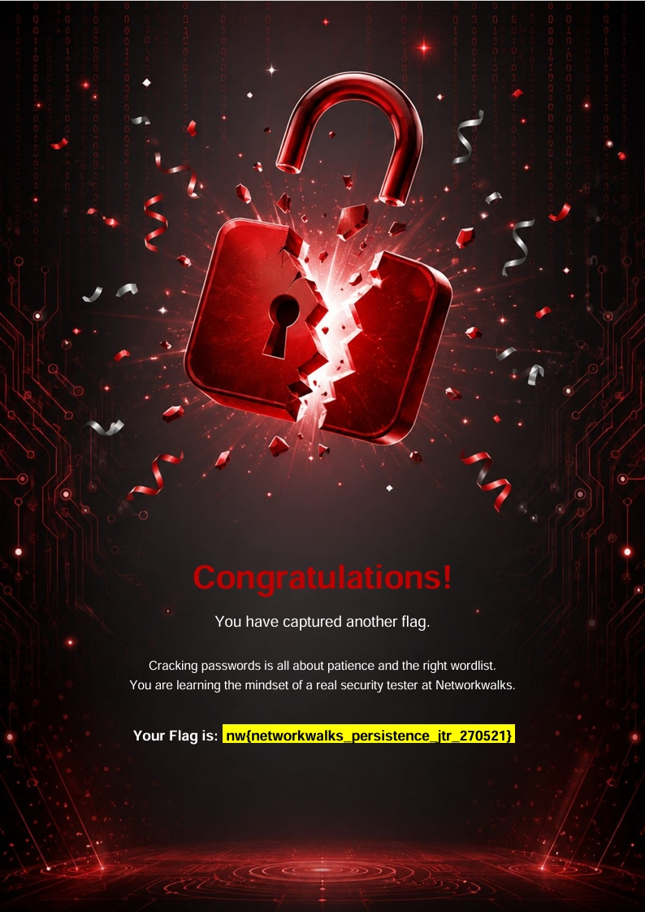

<h1>🔐 PASSWORD CRACKING & SECURITY TESTING</h1>

<h3>NETWORKWALKS | CYBERSECURITY & ETHICAL HACKING</h3>

<strong>WEEK 3 — PROJECT MODULES 1 & 2</strong>

Hands-on cybersecurity exercises involving PDF hash extraction,
password recovery, and password security testing using
John the Ripper and NetworkWalks security tools.

---

## 📌 PROJECT OVERVIEW

This repository documents my successful completion of two practical projects under the NetworkWalks Cybersecurity & Ethical Hacking training program.

The exercises focused on password cracking techniques, extracting password hashes from protected PDF documents, and recovering passwords using different cybersecurity tools.

I completed the projects using two approaches:

- **Project 1:** John the Ripper (JTR) and Johnny GUI — successfully recovered passwords from three protected PDF files.
- **Project 2:** NetworkWalks Hash Calculator and Password Cracker — successfully recovered the password of another protected PDF file.

**Total: 2 projects completed | 4 PDF password recoveries.**

## 🎯 PROJECT OBJECTIVES

- Understand password hashing and password recovery techniques.
- Extract password hashes from encrypted PDF documents.
- Configure and use John the Ripper.
- Perform password recovery using Johnny GUI.
- Explore browser-based password recovery tools.
- Understand password vulnerabilities and the importance of strong authentication.

---

# 🧪 PROJECT 1: PASSWORD CRACKING WITH JOHN THE RIPPER (JTR)

**Week 3 | Project Module 1**

### 🛠️ Tools & Technologies

- John the Ripper (JTR)
- Johnny Graphical User Interface
- PDF Hash Extractor
- Windows PC
- Notepad

### ⚙️ Implementation Process

1. Downloaded and configured John the Ripper and Johnny GUI.
2. Configured Johnny to use the John executable (john.exe).
3. Obtained the three password-protected PDF files provided for the exercise.
4. Extracted the PDF password hashes using an online PDF hash extraction tool.
5. Saved the extracted hashes in text files.
6. Imported the hash files into Johnny.
7. Initiated password recovery attacks using John the Ripper.
8. Successfully recovered the passwords for all three PDF files.
9. Verified the recovered passwords by opening the protected documents.

### 🏆 Results: Three Successful Password Recoveries

**Result 1 – Locked PDF 1**

<em>Figure 1: Successful completion and flag capture for Locked PDF 1.</em>

**Result 2 – Locked PDF 2**

<em>Figure 2: Successful completion and flag capture for Locked PDF 2.</em>

**Result 3 – Locked PDF 3**

<em>Figure 3: Successful completion and flag capture for Locked PDF 3.</em>

### ✅ Project 1 Outcome

Successfully completed all three password recovery exercises using John the Ripper and Johnny GUI.

**Achievement: 3/3 PDF files successfully recovered.**

---

# 🧪 PROJECT 2: PASSWORD CRACKING WITH NETWORKWALKS TOOLS

**Week 3 | Project Module 2**

### 🛠️ Tools & Technologies

- NetworkWalks Hash Calculator
- NetworkWalks Password Cracker
- Web Browser
- Windows PC

### ⚙️ Implementation Process

1. Downloaded the provided password-protected PDF sample.
2. Accessed the NetworkWalks Hash Calculator.
3. Uploaded the protected PDF to extract its password hash.
4. Copied the complete extracted hash beginning with `$pdf$`.
5. Opened the NetworkWalks Password Cracker.
6. Submitted the extracted hash to initiate password recovery.
7. Successfully retrieved the PDF password.
8. Verified the recovered password by opening the protected PDF document.

### 🏆 Result: Successful Password Recovery

<em>Figure 4: Successful completion and flag capture using NetworkWalks tools.</em>

### ✅ Project 2 Outcome

Successfully completed the password recovery exercise using NetworkWalks' browser-based tools.

**Achievement: 1/1 PDF file successfully recovered.**

---

## 🧠 TECHNICAL SKILLS DEMONSTRATED

| Technical Skill | Practical Application |
|---|---|
| John the Ripper | Password recovery |
| Johnny GUI | Graphical password testing |
| PDF Hash Extraction | Extracting password hashes |
| Hash Analysis | Understanding PDF hash formats |
| Password Cracking | Password recovery techniques |
| Windows Environment | Security tool configuration |
| Ethical Hacking | Authorized security testing |

## 📚 KEY LEARNING OUTCOMES

Through these practical exercises, I strengthened my understanding of:

- How password hashes are extracted from protected PDF documents.
- How password recovery tools process extracted hashes.
- Using graphical and browser-based password recovery tools.
- Understanding password vulnerabilities and weak authentication.
- The importance of strong passwords and secure authentication mechanisms.

## 🛡️ ETHICAL CONSIDERATIONS

All exercises were performed within the NetworkWalks training environment using the provided sample PDF documents.

Password testing and recovery should only be conducted on files, systems, and accounts that you own or have explicit authorization to assess.

---

## 🏆 PROJECT COMPLETION SUMMARY

| Project | Tool / Platform | Results | Status |
|---|---|---:|---|
| Project 1 | John the Ripper & Johnny | 3 PDFs recovered | ✅ Completed |
| Project 2 | NetworkWalks Tools | 1 PDF recovered | ✅ Completed |
| **TOTAL** | **Two approaches** | **4 PDFs recovered** | **✅ Completed** |

<h2>🎓 TRAINING PROVIDER</h2>

<h3>NetworkWalks</h3>

Cybersecurity & Ethical Hacking Training

<a href="https://www.networkwalks.com/">
www.networkwalks.com
</a>

<h3>🔐 CONTINUOUS LEARNING. PRACTICAL SKILLS. STRONGER SECURITY.</h3>

Building practical cybersecurity skills through hands-on
laboratory exercises, ethical hacking, and continuous learning.

